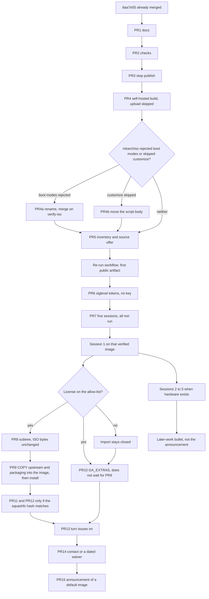

# GA-Next remaining work

| Field | Value |
| --- | --- |
| Author | GA-Next maintainer |
| Date | 2026-10-15 |
| Status | Accepted |
| Repository | https://github.com/mikzero/os (`docs/ga-next-remaining-work.md`, fork of https://github.com/substring/os) |
| Tree this document was checked against | `08556c9654471b208570bd905d9781c09b89efc0` (`master`, clean, even with `origin/master`) |
| Scope | Work that is not started after the fork bootstrap and the 2026 Arch package alignment. Already merged work is not redesigned. |

This document is the executable plan. `docs/ga-next.md` stays a status record. It must keep the sentence "This document is not an executable roadmap."

There is one sequence. It is the Order list, the flowchart, Key decision 1, the Rollout, and the PR plan. No other order is implied.

## Overview

`mikzero/os` at `08556c9` is still the GroovyArcade Archiso profile. The ISO name, boot menu labels, `install_dir`, and default frontend are unchanged. Two fork commits are already merged: documentation bootstrap (`1b2c947`, merge `2a50440`) and the Arch 2026 package alignment (`8aa7e55`, merge `08556c9`). The written baseline still describes the pre-alignment tree. No ISO has been produced from `08556c9`. `.gitlab-ci.yml` runs `./release.sh` after the build. Only `build_iso_testing` has an environment URL, and that URL is `https://github.com/substring/os/releases/tag/$CI_COMMIT_REF_SLUG`. `build_iso` has no environment URL.

The sequence is: PR1 docs, PR2 checks, PR3 publish guard, PR4 a self-hosted image build that does not upload until a source offer exists, conditional boot fixes only if `mkarchiso` forces them, PR5 license inventory and source offer, the first public artifact, PR6 a siglevel token check with no key, PR7 a five-session table left at `not-run`, session 1 on that verified image, then the license gate. PR10, the `GA_EXTRAS` mechanism with no tokens, merges on both outcomes of that gate. It does not depend on PR8 or PR9 and does not wait for PR9. If the license is on the allow-list, PR8 is a subtree import that does not change the ISO, PR9 copies `upstream/` and `packaging/` into the image and builds those subtree SHAs into the ISO, and PR11 and PR12 (ES-DE and Game Boy) open only when the squashfs hash of those rebuilt packages matches. If the license is missing, import stays closed and PR8, PR9, PR11, and PR12 stay closed. Either way the path then continues through issues, contact or a dated waiver, and announcement. A missing license still merges PR10. That closed-import edge is PR10, then issues, contact, announcement. Attract-Mode Plus stays the default. One maintainer reviews each PR on its own.

## Background and motivation

### Verified baseline

Re-checked in the working tree on 2026-10-15:

- `HEAD` is `08556c9` (2026-10-14), "Merge pull request #2 from mikzero/feat/2026-arch-packages". `git status` is clean and `master` matches `origin/master`.
- Merge-base with upstream `substring/os` `master` is `fc91600` (2025-11-18), "Fix fail with missing fallback kernels". Upstream `master` has no commits after that (`pushed_at` 2025-11-18T22:11:38Z). This fork is four commits ahead: `1b2c947`, `2a50440`, `8aa7e55`, `08556c9`.
- `groovyarcade/profiledef.sh` sets `iso_name="groovyarcade"`, `iso_publisher="Substring"`, `iso_application="GroovyArcade Install/Live CD"`, `install_dir="groovyarcade"`. `buildmodes` is `iso`. `bootmodes` is still `bios.syslinux.mbr`, `bios.syslinux.eltorito`, `uefi-x64.systemd-boot.esp`, `uefi-x64.systemd-boot.eltorito`. `build.sh` passes `-D groovyarcade` to `mkarchiso`.
- `groovyarcade/airootfs/home/arcade/shared/configs/ga.conf` is exactly `frontend=attractplus` and `video.backend=KMS`.
- The default 15 kHz entry passes `video=640x480iS` in `groovyarcade/syslinux/syslinux.cfg` (`LABEL [15khz]`) and `groovyarcade/efiboot/loader/entries/ga-15khz.conf`. `groovyarcade/efiboot/loader/loader.conf` sets `default ga-15khz.conf` and `timeout 15`.
- Other shipped `video=` values, which stay locked until a CRT-gated PR changes them: syslinux `[25khz]` `video=512x384S`, `[31khz]` `video=640x480S`, `[Intel and Nvidia 15kHz]` `video=1280x480iS`, `[NTSC]` `video=720x480iS`, `[PAL]` `video=768x576iS`, both EDID labels `video=e`. `[SVGA/LCD Monitor]` has no `video=` argument. The EFI entries match those arguments. `ga-15khz.conf` and the two EDID entries use `%ARCH%` on the initrd path. `ga-25khz.conf`, `ga-31khz.conf`, `ga-intel-nvidia.conf`, `ga-ntsc.conf`, `ga-pal.conf`, and `ga-svga.conf` hardcode `x86_64` in the initrd path. The syslinux Intel/Nvidia label hardcodes one initrd as `/groovyarcade/boot/%ARCH%/initramfs-linux-15khz.img`. None of those path quirks are scheduled.
- The target cabinet is documented only: an AMD/ATI GPU with analogue output (VGA or DVI-I), a 15 kHz CRT, and a JAMMASD board. JAMMASD carries VGA onto the JAMMA edge and presents controls as a USB HID keyboard. No JAMMASD driver is in the tree. None is added by this plan.
- `groovyarcade/packages.x86_64` has 106 uncommented lines. It includes `linux-15khz`, `switchres`, `groovymame`, `attractplus`, `gasetup`, `gatools`, `galauncher`, `xf86-video-ati`, `xf86-video-amdgpu`, `udiskie`, `lxde-common`, `lxde-icon-theme`, `lxsession`, `lxpanel`, `pcmanfm`, `lxterminal`, and `xorg-mkfontscale`. The 2026 alignment removed the `lxde` metapackage (those six packages replaced it), replaced `xorg-mkfontdir` with `xorg-mkfontscale`, and removed `mesa-vdpau`. Commented lines include `#retroarch`, `#mednafen`, `#mupen64plus`, `#snes9x`, `#stella`, `#yabause-gtk`, `#advancemenuplus-git`, and `#amdvlk`. `haveged` was never a line in this file. Emulator sources are not in this tree.
- `8aa7e55` dropped `haveged` from `Dockerfile` and the `Wants=`/`After=` on `haveged.service` in `groovyarcade/airootfs/etc/systemd/system/pacman-init.service`, and removed the `reflector.service` enablement symlink from `multi-user.target.wants`. `reflector` remains a package. Reflector still runs while the image is built (`.gitlab-ci.yml` `before_script`, and `Dockerfile`). No ISO was built for that commit.
- `udiskie` is installed and not enabled. The user unit exists and is not linked from `default.target.wants`. The line in `.bash_profile` left by upstream `70e73e6` is exactly `#systemctl --user daemon-reload && systemctl --user enable udiskie`. That is the in-tree explanation of upstream issue `#63`. Issue `#65` is the default 15 kHz `video=640x480iS`. Neither was intentionally changed by this fork.
- `docs/ga-next.md` is stale. It says the document records the fork as it stands on `fc91600`, and that the bootstrap does not change the package list. It does not mention `08556c9` or the 2026 delta. `README.md` line 3 still says "The ISO name, boot menu, and package list are unchanged." The ISO name and boot menu are unchanged. The package list is not.
- `scripts/check-ga-next-docs.sh` requires "This document is not an executable roadmap." and "None of the items in this section is implemented." It requires the README sentence that ES-DE and Game Boy are planned and are not part of the current ISO. It forbids "ES-DE is included", "Game Boy support is included", "Download GA-Next", and `github.com/mikzero/os/releases`.
- `gasetup`, `gatools`, `galauncher`, and the package sources are not in this tree. `release.sh` `prepare_description` clones three repositories, and only those three: `https://gitlab.com/groovyarcade/packages.git`, `https://gitlab.com/groovyarcade/tools/gatools.git`, and `https://gitlab.com/groovyarcade/gasetup.git`. It does not clone galauncher. The changelog checkout is not an inventory and it does not vendor those trees. `groovy-ux-repo.conf` points pacman at `https://github.com/substring/packages/releases/download/stable` with `SigLevel = PackageOptional`. The testing block above it is commented. `build.sh` `use_git_pkg` rewrites only the names `gatools`, `gasetup`, and `galauncher` to their `-git` forms. Nothing in `use_git_pkg` installs a file from this git tree.
- `settings` sets `GA_VERSION=testing` unless `RELEASE`, `CI_COMMIT_TAG`, or a non-master `CI_COMMIT_REF_SLUG` is set. A GitLab `master` build therefore leaves `GA_VERSION=testing`, and `build.sh` enables the testing repo and the `-git` packages. A tag matching `[0-9]{4}\.[0-9]{2}` stays on the stable repo. This plan does not silently change that.
- Continuous integration is `.gitlab-ci.yml` only. `build_iso` on `master` and tags runs `./build.sh` in `before_script`, then `./release.sh -dcip`. `build_iso_testing` on other branches runs `./release.sh -dci`. `clean_release` downloads `github-release` 0.10.0 and runs `github-release delete` with no repository argument. There is no `.github/workflows` directory. `builder.sh` is the local path: `docker build` from `Dockerfile`, then `docker run --privileged`. Compression (`xz -T 0`) is a GitLab step, not part of `build.sh`. `xz` removes the uncompressed ISO unless `-k` is passed.
- GitHub: `mikzero/os` is public, `has_issues` is false, `has_discussions` is false, license metadata is GPL-3.0, zero releases. `substring/os` has issues enabled and `open_issues_count` 10 on 2026-10-15. Upstream license detection is null. This fork's GPL statement is the `LICENSE` file added in `1b2c947`. Upstream releases, not re-published here: Latest `2024.07` (2024-07-17), pre-release `2025.08`, `testing` tag updated 2026-08-27.
- License of this repository is GPL-3.0-or-later. `CONTRIBUTING.md` says boot, video, kernel cmdline, and package-list changes are not merged without review and a CRT test. The one exception this plan allows is PR4a, and only in the deadlock described under conditional archiso compatibility. Documentation-only changes still need review and do not need a CRT session.
- `customize_airootfs.sh` creates the samba user with password `arcade` (`(echo "arcade"; echo "arcade") | smbpasswd`). That is upstream behavior. This plan does not rotate it.
- The git tree is about 100 MB (`size` 102630 KB). This plan does not add ROMs.

### Why the written baseline blocks later work

`scripts/check-ga-next-docs.sh` passes today and does not notice that the baseline paragraph is false after `8aa7e55`. A green checker will bless later text that still says the package list did not change. ES-DE and Game Boy must not be added while that disagreement stands.

### What is outside this tree, and why it matters

Fetched read-only on 2026-10-15. Not vendored.

`gitlab.com/groovyarcade/tools/galauncher` master contains `startfe.sh` (blob `0dbb76d554243e5ae69a1305730e072dfaa18149`). For `video.backend=KMS` the arms are `attractplus`, `retrofe`, `pegasus-frontend`, `groovymame`, `retroarch`, and `emulationstation`. Anything else logs "Atttempted to start a non existant frontend" and exits 1. There is no `es-de` arm. `galauncher.sh` (blob `e2da7bf6d3f24c6b73219cac503a74d52269ebf0`) is an emulator launcher. Its `emulators/` directory is `emu4crt.sh`, `fbneo.sh`, `groovymame.sh`, `mame.sh`, and `retroarch.sh`. There is no `mgba.sh`. `release.sh` does not clone this repository.

`gitlab.com/groovyarcade/tools/gatools` master contains `features.yaml` (blob `56d45330d5fa83fabf5bd4c9204e7fbd5940cc5e`). System keys `gb`, `gbc`, and `gba` are present and empty. `nes` is the shape a filled system takes. `.bash_profile` calls `/opt/gatools/video/video.sh` and then `sudo gasetup`. `customize_airootfs.sh` calls `/opt/gasetup/gasetup.sh` for `groovyarcade`, `attract`, and `groovymame`.

`github.com/substring/packages` `packages_groovy.lst` on master is 30 lines and does not list `emulationstation-de`, `es-de`, or `mgba`. `pegasus-frontend` is not a stand-in for ES-DE.

Root listings for `gasetup`, `gatools`, and `galauncher` showed no `LICENSE` file. The tops of `gasetup.sh` and `startfe.sh` had no SPDX line. A missing license blocks import. It is not permission to import.

Editing a file under a future `upstream/` directory does not change the ISO. `use_git_pkg` only renames three package strings. The bytes that land in `/opt/gatools` and in the galauncher install prefix are whatever the groovy pacman repo shipped. A product PR that edits yaml or shell in git, and then talks about what the cabinet launches, is false until a package-build step installs those bytes and a post-build check hashes them out of the squashfs.

### Pain

One maintainer cannot review an import, a new frontend, a signing key, and an announcement as one change. The current `release.sh` path can create a GitHub Release on whatever `GITHUB_USER`/`GITHUB_REPO` the environment names, including case variants of `substring/os`. The 2026 package delta is merged and unbuilt. A GitHub-hosted `ubuntu-latest` runner cannot hold this build. CRT time cannot be simulated from this session.

## Goals and non-goals

### Goals

1. Make `docs/ga-next.md`, `README.md`, and `scripts/check-ga-next-docs.sh` describe `08556c9`, including the Arch 2026 delta, without turning `docs/ga-next.md` into a roadmap.
2. Define a static profile check and a post-`mkarchiso` check. State which failures are code failures and which only a CRT session can close.
3. Produce a verified ISO of this fork on a machine that has the disk, store a public copy only as an Actions artifact on `mikzero/os` or as a maintainer-held file with a committed manifest, and do not create a GitHub Release. Do not upload to `substring/os`.
4. Keep Attract-Mode Plus, `video.backend=KMS`, every shipped `video=` argument, the syslinux `LABEL` lines, `bootmodes`, `iso_name`, `install_dir`, `build.sh -D groovyarcade`, and `iso_publisher` stable until the PR that is explicitly about that line.
5. Keep ES-DE and Game Boy out of the default ISO. A later extra may exist only after the image that boots it contains the edited `startfe.sh` or `features.yaml`, and only behind `GA_EXTRAS`.
6. Import sources only with a license on the allow-list below, then install them with a package build. Do not treat a subtree commit as an ISO change. GPL-3.0-or-later of this repository stays. Do not re-sign Substring's binaries.
7. Record five CRT sessions, contact, and the announcement as gates. Do not write a message as if it had been sent.
8. Leave each PR independently reviewable by one person.

### Non-goals

- Renaming the ISO, the boot menu labels, or `install_dir`. The hardcoded `/groovyarcade/` initrd and the EFI `x86_64` initrd paths are reasons not to rename `install_dir` here. `iso_publisher` stays `Substring`.
- Enabling `udiskie`, uncommenting the `.bash_profile` line, or changing any `video=` argument. `#63` and `#65` are not scheduled. A PR that touches them must say so and needs a CRT session.
- Replacing Attract-Mode Plus as the default frontend.
- Adding RetroArch, mednafen, mGBA, gambatte, ES-DE, or pegasus to the default `packages.x86_64`.
- Vendoring `substring/packages` PKGBUILDs, or re-signing those release assets.
- Claiming a CRT result for a file the squashfs does not contain.
- Defining or implementing `ga-tools`. The string is not defined in this tree.
- Adding Game Boy ROMs or boot ROMs.
- Turning GitHub issues on inside a code diff. The setting changes first. A doc sentence records it only after the API would agree.
- Using `ubuntu-latest` to build the ISO.

## Proposed design

### Order

This is the only order:

1. PR1 docs, PR2 checks, PR3 publish guard, PR4 self-hosted build (verify, do not upload until the source offer exists).
2. PR4a and PR4b only if the build log forces them.
3. PR5 inventory and source offer, then the first public artifact (a re-run, not a new PR).
4. PR6 siglevel token check, no key.
5. PR7 session table, all `not-run`, then session 1 against that verified image.
6. License gate. PR8, then PR9, only if the license is on the allow-list. PR8 does not change ISO bytes. PR9 adds `COPY upstream /work/upstream` and `COPY packaging /work/packaging` to `Dockerfile` and builds those copied subtree SHAs. A missing license leaves import closed and does not open PR8 or PR9.
7. PR10 merges on both outcomes of that gate. It does not depend on PR8 or PR9 and does not wait for PR9. A missing license still merges it. The closed-import path is PR10, then issues, contact, and announcement.
8. PR11 ES-DE and PR12 Game Boy only when PR9's squashfs hash matches. They stay closed when import is closed, and they stay off the default ISO.
9. PR13 issues on, PR14 contact or a dated waiver, PR15 announcement.

Session 1 and PR8 do not run in parallel. Import stays closed until session 1 is recorded as `pass` or `fail` on the verified image. PR6 may be reviewed in parallel with that session, because it does not change the bytes the session boots. Sessions 2–5 do not block import, product PRs, or the announcement. They block only the later-work bullet those rows belong to.

Product diffs in gatools or galauncher do not start until both the license allow-list has passed and PR9's hash check shows those files in the squashfs. PR10 is not that product diff. It is the extras mechanism, and it does not wait for PR9.



PR10 has no edge from PR9. Both license outcomes reach it: the allow-list decision, and `Closed` when the license is missing. The closed-import edge is `Closed`, then PR10, then issues, contact, and announcement. PR11 and PR12 stay on the allow-list edge, behind the squashfs hash of the rebuilt packages, and that edge still reaches issues. The `PR10` to issues edge is how a missing license continues. It is not a second order and it is not permission to skip PR11 and PR12 when the hash matches.

PR9 installs the rebuilt packages only by copying the trees into the image. Its `Dockerfile` adds `COPY upstream /work/upstream` and `COPY packaging /work/packaging`. The packages are built from those copied subtree SHAs. The master `docker run` and `builder.sh` both pass `-e GA_FORK_PACKAGES`. The squashfs hash of `features.yaml` and `startfe.sh` is the proof those copied sources were installed. The default ISO contains the rebuilt packages only on that path.

### Documentation baseline

PR1 edits `docs/ga-next.md` in place. It does not add a roadmap, a PR checklist, or build commands.

Replace the status paragraph that says the fork stands on `fc91600`. Keep `fc91600` as the upstream merge-base. The new status records `HEAD` `08556c9`, the merge-base, that `1b2c947` did not change the ISO, and that the package and live-service delta is `8aa7e55`.

Under Current baseline, match the commented list to `packages.x86_64` and state the 2026 delta as facts:

- `lxde` metapackage removed. The installed pieces are `lxde-common`, `lxde-icon-theme`, `lxsession`, `lxpanel`, `pcmanfm`, `lxterminal`.
- `xorg-mkfontdir` replaced by `xorg-mkfontscale`.
- `mesa-vdpau` removed from the package list.
- `haveged` removed from `Dockerfile` and from `pacman-init.service`. It was not a line in `packages.x86_64`.
- `reflector.service` is not enabled on the live system. The `reflector` package remains. Reflector still refreshes the mirrorlist during the image build.
- Exact checker sentence: `No ISO has been built from 08556c9.`

Do not leave the old "as it stands on commit" wording beside the new paragraph. The checker forbids that phrase. It does not forbid the sha `fc91600`.

Keep verbatim in PR1:

- `This document is not an executable roadmap.`
- `The ISO is still named groovyarcade.`
- `None of the items in this section is implemented.`
- `Not fixed by the bootstrap.`
- Every Later work bullet, each still "Not started." PR1 does not mark GitHub Actions started. The PR that changes a bullet also replaces the section sentence, in that same commit, so the checker never requires a sentence the file just made false.
- The `#63` and `#65` explanations.

Add this factual sentence, backticks included, because `require_text` is `grep -F`:

`` `ga-tools` is not defined in this tree. ``

The shipped package `gatools` is already in `packages.x86_64` and is not that name.

`README.md` stops saying the package list is unchanged. The ISO name and boot menu are unchanged. The package list was aligned in `8aa7e55`. Keep the ES-DE / Game Boy sentence and "GA-Next has no release of its own yet: the ISO is still built and published as GroovyArcade." Do not add a download link. The upstream README section keeps `https://github.com/substring/os/releases/latest`.

Checker additions in PR1:

- `require_text` for `08556c9`, `8aa7e55`, `lxde-common`, `lxde-icon-theme`, `xorg-mkfontscale`, and `No ISO has been built from 08556c9.`
- `require_text docs/ga-next.md "\`ga-tools\` is not defined in this tree."` The backticks are inside the fixed string. A search for `ga-tools is not defined` without them does not match.
- `forbid_text README.md "package list are unchanged"`
- `forbid_text docs/ga-next.md "as it stands on commit"`
- `forbid_text docs/ga-next.md "ES-DE is included"`
- `forbid_text docs/ga-next.md "Game Boy support is included"`

`scripts/test-check-ga-next-docs.sh` gains one mutation: delete the line `This document is not an executable roadmap.` and assert the checker exits non-zero.

When a later PR changes a Later work bullet, that PR replaces `None of the items in this section is implemented.` with a sentence that names what is actually started and says the other bullets are not. The checker requirement moves with it, in the same commit. PR4 does this for the GitHub Actions bullet. PR6 does not mark signing done. PR15 does this again if the announcement bullet changes. Leaving the old sentence in place is a failed check, not a follow-up.

After the first real `mkarchiso`, a docs commit replaces `No ISO has been built from 08556c9.` with one of these, and updates the checker in that commit:

- Built, not uploaded: `mkarchiso succeeded for <sha> on <date>; image not uploaded; CRT session not run.`
- Uploaded: `A verified image for <sha> was uploaded as an Actions artifact on <date>; CRT session not run.`

The sentence stays a fact. It does not say the picture works.

PR1 does not need a CRT session.

### What an ISO build proves

`scripts/check-profile.sh` and `scripts/verify-iso.sh` are bash, SPDX `GPL-3.0-or-later`, and neither calls `mkarchiso`.

Package lines are matched after stripping blanks and lines whose first non-space character is `#`. A name matches only as a whole line. `lxde-common` does not satisfy a check for `lxde`. `lxde-icon-theme` is required. `haveged` is not on the package list. The Dockerfile and `pacman-init.service` checks are separate: `haveged` must be absent from both.

`check-profile.sh` fails if any of these drift:

| Check | Expected |
| --- | --- |
| `iso_name`, `install_dir`, `iso_publisher` | `groovyarcade`, `groovyarcade`, `Substring` |
| `build.sh` | contains `-D groovyarcade` |
| `bootmodes` | the four strings `bios.syslinux.mbr`, `bios.syslinux.eltorito`, `uefi-x64.systemd-boot.esp`, `uefi-x64.systemd-boot.eltorito`, until PR4a replaces that expected value in the same commit as the profile |
| syslinux `MENU LABEL` lines | `[15khz]`, `[25khz]`, `[31khz]`, `[SVGA/LCD Monitor]`, `[Intel and Nvidia 15kHz]`, `[NTSC]`, `[PAL]`, `[EDID Progressive]`, `[EDID Interlaced]`, `Hardware Detection Tool`, `Boot existing OS` |
| `video=` arguments | the values listed in the baseline, including the two `video=e` entries and the SVGA entry's lack of `video=` |
| `ga.conf` | `frontend=attractplus` and `video.backend=KMS`, nothing else |
| `loader.conf` | `default ga-15khz.conf` |
| `.bash_profile` | the full line `#systemctl --user daemon-reload && systemctl --user enable udiskie` |
| `packages.x86_64` whole lines | required: `lxde-common`, `lxde-icon-theme`, `lxsession`, `lxpanel`, `pcmanfm`, `lxterminal`, `xorg-mkfontscale`, `attractplus`, `linux-15khz`, `udiskie`. Forbidden as whole lines: `lxde`, `mesa-vdpau`, `xorg-mkfontdir`, `retroarch`, `es-de`, `emulationstation-de`, `mgba`, `gambatte`, `amdvlk`. Do not forbid the substring `emulationstation`. `startfe.sh` already knows that name, and it is not a package in this list. |
| `Dockerfile`, `pacman-init.service` | no `haveged` |
| `groovy-ux-repo.conf` | stable URL unchanged; testing block commented in git; siglevel tokens as PR6 specifies. PR2 locks today's line `SigLevel = PackageOptional` and rejects `TrustAll`. PR6 replaces that lock with the token parser. |
| `groovyarcade/pacman.conf` | Split the options `SigLevel` value on whitespace. Require the token `Required`. Reject the tokens `Optional`, `TrustAll`, `Never`, `PackageNever`, and `DatabaseNever`. Keep the token `DatabaseOptional`. The committed line is `SigLevel    = Required DatabaseOptional`. A substring search for `Optional` fails this tree, because `DatabaseOptional` contains those letters and is a different token. `LocalFileSigLevel = Optional` stays legal and is a different key. The commented `#SigLevel = Optional TrustAll` is not this check. The uncommitted `[ga-next-local]` line `SigLevel = Optional` is not in a committed file and is not this check. |
| `settings` | default `GA_VERSION=testing` |
| workflows and `.gitlab-ci.yml` | no `release.sh` invocation. `clean_release` absent after PR3. |

`verify-iso.sh <output-dir>` runs on the uncompressed ISO, before `xz`. It collects failures and exits non-zero if any fired. It does not stop at the first failure. Checks:

- The file `groovyarcade-*-x86_64.iso` exists and is at least 512 MiB. 512 MiB is a non-empty floor, not an expected size. The script prints the size.
- `pkglist.x86_64.txt` exists and passes the same whole-line package rules.
- `xorriso -indev` on that uncompressed ISO sees an El Torito catalog. Extracted syslinux and `ga-15khz.conf` contain `video=640x480iS` and do not contain the unreplaced token `${KRNL_CMDLINE}`.
- The squashfs at `groovyarcade/x86_64/airootfs.sfs` inside the ISO yields `/etc/locale.gen` with `en_US.UTF-8` uncommented. That is the marker that `customize_airootfs.sh` ran. A commented line fails the build.
- The same squashfs yields `home/arcade/shared/configs/ga.conf` equal to the two locked lines.
- If the caller, the environment, or a pre-seeded manifest sets `crt_session` to anything but empty or `not_run`, the script fails. It then writes `crt_session=not_run`. There is no flag that writes `pass`.

`scripts/test-verify-iso.sh` builds one tiny fixture: a few-kilobyte file named like an ISO, an extracted cfg containing `${KRNL_CMDLINE}`, a `locale.gen` whose `en_US.UTF-8` line is commented, and a manifest with `crt_session=pass`. One run must report all four failures: size floor, unreplaced token, commented locale, and the refused CRT pass. A second case with those defects repaired except the size still fails the floor, so a green fixture cannot be faked with a tiny file.

`build.sh` appends `build-manifest.txt` beside the pkglist. It does not change the `GA_VERSION` condition. Fields it knows: `ga_version`, `testing_repo`, `git_packages`, `extras`, `archiso_version`, `groovy_repo_siglevel` (the line after `enable_testing_repo`, if that ran). `git_sha` is often unknown inside the image because `Dockerfile` does not copy `.git`. The host step after the container exits writes `git_sha`.

Hash order, which is also the workflow order:

1. `verify-iso.sh` on the uncompressed ISO.
2. Host writes `iso_uncompressed_sha256` of that ISO.
3. `xz -T0` without `-k`, which deletes the uncompressed file.
4. Host writes `iso_sha256` as the SHA-256 of the `.iso.xz`. That is the file that is uploaded. `iso_sha256` is not the hash of the uncompressed ISO.
5. Upload, when the source-offer gate allows it, the `.xz`, the pkglist, and the manifest. Not the uncompressed ISO.

A green `verify-iso.sh` does not satisfy `CONTRIBUTING.md` for a package-list or boot change. `8aa7e55` stays "merged, not CRT-verified" until session 1 is filled. PR1–PR4 are not blocked on that session. A later change to `packages.x86_64`, the boot entries, or `ga.conf` is blocked on a CRT session of an image that contains the change. PR4a is the only exception, and only when no image builds at all.

### Conditional archiso compatibility

Archiso v86 (2025-09) deprecates the four `bootmodes` names and rewrites them to `bios.syslinux` and `uefi.systemd-boot`. Removal is still open as archiso issue 242. `customize_airootfs.sh` line 7 already says the script is deprecated. Neither has been executed against current `archlinux:latest` from this tree.

- If `mkarchiso` only warns, do not rename. Record the warning. Leave the names until a run rejects them.
- If `mkarchiso` rejects the boot-mode names, no ISO exists to boot, so a CRT session cannot be a precondition of the fix. PR4a may merge on a green `verify-iso.sh` of the fixed tree: El Torito catalog present, every `video=` argument unchanged, labels unchanged, `install_dir` unchanged. `check-profile.sh`'s expected `bootmodes` value changes in that same commit. This is an explicit exception to `CONTRIBUTING.md`, written here so the PR does not pretend the CRT already happened. Session 1 of that new SHA is the CRT. It is required before any announcement and before any further boot edit. Do not open PR4a on a warning alone.
- If the uncompressed ISO builds but `locale.gen` shows `customize_airootfs.sh` did not run, PR4b moves that script's body, unchanged, including the three `gasetup.sh` calls, to the entry point that archiso version still runs. The branch can build an image, so this is not the PR4a deadlock. Merge still needs a CRT of that branch image, because the script configures the live system. If `mkarchiso` will not produce any image until the body moves, PR4b uses the same exception as PR4a: merge on `verify-iso.sh` showing the locale marker, and session 1 of that SHA before announcement and before any further boot edit.

### CI artifact for this fork

PR3 lands before PR4.

`release.sh` gains this guard before option parsing, after the existing emptiness checks. The dry-run exit is part of the same block, still before `getopts`:

```bash
user_lc=${GITHUB_USER,,}
repo_lc=${GITHUB_REPO,,}
if [[ "$user_lc" == "substring" && "$repo_lc" == "os" && "${ALLOW_UPSTREAM_RELEASE:-}" != "1" ]]; then
  echo "refusing to publish onto substring/os" >&2
  exit 1
fi
if [[ "${RELEASE_GUARD_DRY_RUN:-}" == "1" ]]; then
  echo "guard passed" >&2
  exit 0
fi
```

The comparison is case-insensitive. `Substring/OS` is the same repository as `substring/os`, and `gh -R` will target it. The guard rejects that pair only. It does not reject `mikzero/os`. Default is refuse. A manual upstream publish can still set `ALLOW_UPSTREAM_RELEASE=1`. This fork's workflows never set it, never set `RELEASE_GUARD_DRY_RUN`, and never call `release.sh`. GitLab does not set the dry-run either. A real `-c` without the variable still reaches `gh` after the guard. The dry-run is after the refuse, so it cannot skip it, and it exits before `create_release`.

`scripts/test-release-guard.sh` creates an empty `work/` directory so `include.sh` does not exit first. It puts a stub `gh` on `PATH` that appends its arguments to a log and exits 0. The static job checks out with `actions/checkout` at depth 1 and with no tags. `release.sh -c` calls `create_release`, and `prepare_description` runs `git describe --tags --abbrev=0 @^`, three `git clone`s, and a read of `/work/output/pkglist.x86_64.txt` before `gh`. Those steps are not part of this test. No live token. The stub does not network.

The dry-run is after the refuse, so it cannot skip it. It exits before `getopts`, so `-c` does not call `create_release`, `git describe`, the three clones, or the pkglist read.

Cases, each with `GITHUB_TOKEN=dummy`, `RELEASE_GUARD_DRY_RUN=1`, and `bash release.sh -c`:

- `GITHUB_USER=Substring`, `GITHUB_REPO=OS` exits 1, stderr contains `refusing to publish onto substring/os`, and the stub log is empty.
- `GITHUB_USER=substring`, `GITHUB_REPO=os` does the same.
- `GITHUB_USER=mikzero`, `GITHUB_REPO=os` exits 0, stderr contains `guard passed`, and the stub log is empty. `gh` is not the signal. Exit 0 and `guard passed` are the signal, and they do not need tags, clones, or `pkglist.x86_64.txt`.

A missing guard fails the `Substring`/`OS` cases: stderr lacks `refusing to publish onto substring/os`. The allow-case is not that detector. Setting the dry-run on the refuse cases is what fails a patch that checks the variable before the guard.

On this fork, `.gitlab-ci.yml` stops publishing. Removing the calls is the control. The deny-list is only for a manual `release.sh`.

- `build_iso` and `build_iso_testing` no longer run `release.sh`. Their `script` is `echo "this fork does not publish from GitLab"`. The `before_script` may still build. A build on a GitLab runner is not an Actions artifact and is not a Release.
- The `clean_release` job is deleted. It is not routed through `release.sh`, it passes no repository, and the guard would not cover it.
- The one environment URL, on `build_iso_testing` only, changes from `https://github.com/substring/os/releases/tag/$CI_COMMIT_REF_SLUG` to `https://github.com/mikzero/os`. No `/releases` suffix. `build_iso` has no environment block. Do not add one.
- `.gitignore` gains `GITHUB_TOKEN`. `release.sh` may keep reading `./GITHUB_TOKEN` for a manual run. Do not print it.

PR4 adds `.github/workflows/iso.yml`. Static job on `ubuntu-latest`. Build job not on `ubuntu-latest`.

GitHub's hosted-runner table lists `ubuntu-latest` as 4 vCPU, 16 GB RAM, and 14 GB SSD. A measurement of those images shows about 19 GB free before deleting preinstalled tools. This profile needs a pacman cache, a rootfs, the xz squashfs from `profiledef.sh`, and a second `xz` of the ISO. A 20 GB preflight on that runner fails closed, and the disk is too small even if the preflight were lowered. The build job therefore uses a self-hosted runner labeled `ga-iso`. The preflight reads `df -PB1` on the work filesystem and exits 1 with `runner disk too small` unless at least 40 GiB is free. Forty GiB is the number for that runner, chosen because the hosted 14 GB disk cannot do this job, not because 20 GB was a round guess. The maintainer may switch `runs-on` to a GitHub larger runner (the 4-vCPU larger Ubuntu runner has a 150 GB SSD and is not free) by editing that one field. The workflow must not fall back to `ubuntu-latest`.

The owner of `mikzero/os` registers that runner on this repository. It is a repository runner, not an organization runner. The organization runner-group checkbox that allows public repositories is a different setting and is not used. The machine is disposable. It has no other secrets, no other workloads, and no token that can write `substring/os`. `docker run --privileged` can root it, so it is rebuilt between jobs. A job whose labels match no online runner stays queued. `timeout-minutes: 180` starts after a runner picks the job up. It does not expire the queue. PR4 may merge on a `builder.sh` manifest while no runner is registered. `iso.yml` is not a required status check until a runner is online and a build has completed.

```yaml
name: iso
permissions:
  contents: read
concurrency:
  group: iso-${{ github.ref }}
  cancel-in-progress: false
on:
  pull_request:
  push:
    branches: [master]
    paths:
      - "groovyarcade/**"
      - "build.sh"
      - "builder.sh"
      - "Dockerfile"
      - "settings"
      - "globals"
      - "include.sh"
      - "groovy-ux-repo.conf"
      - "scripts/verify-iso.sh"
      - "scripts/check-profile.sh"
      - "docs/source-offer.md"
      - ".github/workflows/iso.yml"
  workflow_dispatch:
    inputs:
      extras:
        description: "Rejected until PR10. Must match ^[a-z0-9,-]*$."
        required: false
        default: ""
jobs:
  static:
    if: github.repository == 'mikzero/os'
    runs-on: ubuntu-latest
    steps:
      - uses: actions/checkout@<pin>
      - run: bash scripts/check-ga-next-docs.sh
      - run: bash scripts/test-check-ga-next-docs.sh
      - run: bash scripts/check-profile.sh
      - run: bash scripts/test-verify-iso.sh
      - run: bash scripts/test-release-guard.sh
  build:
    if: >
      github.repository == 'mikzero/os' &&
      (github.event_name == 'workflow_dispatch' ||
       (github.event_name == 'push' && github.ref == 'refs/heads/master'))
    runs-on: [self-hosted, ga-iso]
    timeout-minutes: 180
    steps:
      - uses: actions/checkout@<pin>
      - name: Refuse the wrong repository
        run: test "${GITHUB_REPOSITORY}" = "mikzero/os"
      - name: Validate extras and disk
        env:
          GA_EXTRAS: ${{ github.event.inputs.extras }}
        run: |
          set -euo pipefail
          extras="${GA_EXTRAS:-}"
          [[ "$extras" =~ ^[a-z0-9,-]*$ ]] || { echo "bad GA_EXTRAS" >&2; exit 1; }
          if [[ "${GITHUB_EVENT_NAME}" == "push" && -n "$extras" ]]; then
            echo "master push must not set GA_EXTRAS" >&2
            exit 1
          fi
          # PR4 fails closed on a non-empty value. PR10 removes this refusal.
          if [[ -n "$extras" ]]; then
            echo "GA_EXTRAS is not implemented" >&2
            exit 1
          fi
          avail=$(df -PB1 --output=avail "$PWD" | tail -1)
          test "$avail" -ge $((40 * 1024 * 1024 * 1024)) || {
            echo "runner disk too small" >&2
            exit 1
          }
      - name: Build and verify, then compress
        env:
          GA_EXTRAS: ${{ github.event.inputs.extras }}
        run: |
          set -euo pipefail
          docker build -f Dockerfile -t groovy-ux-os-ci .
          mkdir -p work/output
          docker run --privileged --rm \
            -e GA_EXTRAS \
            -v "$PWD/work/output:/work/output" \
            groovy-ux-os-ci
          bash scripts/verify-iso.sh work/output --require-no-extras
          # host writes git_sha and iso_uncompressed_sha256
          xz -T0 work/output/groovyarcade-*-x86_64.iso
          # host writes iso_sha256 of the .xz
      - name: Upload only when the source offer exists
        if: hashFiles('docs/source-offer.md') != ''
        uses: actions/upload-artifact@<pin>
        with:
          name: groovyarcade-${{ github.sha }}
          path: |
            work/output/*.iso.xz
            work/output/pkglist.x86_64.txt
            work/output/build-manifest.txt
          retention-days: 14
          if-no-files-found: error
```

`GA_EXTRAS` is passed by the step `env:` block and by `-e GA_EXTRAS`, not by interpolating `${{ }}` into the shell script. The regex runs before `docker run`. Until PR10, a non-empty value fails the job. A `push` to `master` always passes `--require-no-extras`.

Pins are full commit SHAs, chosen when the PR is opened. `permissions: contents: read` stays. `contents: write` is what creates a Release. Do not add it to make an upload succeed. Current `upload-artifact` does not need `contents: write`. If the pinned major needs `artifact-metadata: write`, add that scope by name and nothing else.

`github.repository` on `pull_request` is the base repository, not the head fork. A pull request opened against `mikzero/os` from a fork runs the workflow file from the merge commit, so the fork can replace `.github/workflows/iso.yml`, including `runs-on`. The `if:` that keeps the build job off `pull_request` lives in that same file. It is not the boundary that keeps fork code off `ga-iso`. Do not cite it as one. The fork token for an unapproved `pull_request` is read-only and has no secrets. `pull_request_target` must not be added to make a check see the base workflow. That event checks out untrusted code with the base token. It is a different hole from the runner rewrite.

Keep fork workflows off the runner from outside the yaml the PR can edit. Set the repository approval policy to require approval for all outside collaborators, not only first-time contributors. A merged trivial PR is enough for the first-time policy to stop asking. The maintainer does not approve a fork workflow run whose jobs request `self-hosted` or `ga-iso`. Same-repo `push` to `master` and the maintainer's `workflow_dispatch` are what use the label. A same-repo pull request can still edit `iso.yml` before merge and request `contents: write`. With one maintainer that is a footgun on this repo's token. It is not a path to `substring/os`: this design stores no PAT that can write there.

The pasted `docker run` above is the PR4 invocation. It passes `-e GA_EXTRAS` only. It does not set `GA_FORK_PACKAGES`. PR9 edits this file so the master build passes `-e GA_FORK_PACKAGES=1` and adds `upstream/**` and `packaging/**` to `paths`. Do not read the PR4 block as the post-PR9 master build.

The build does not set `RELEASE`, `CI_COMMIT_TAG`, or `GITHUB_USER`. `GA_VERSION` stays `testing`. The manifest must show `testing_repo=yes` and `git_packages=yes`. That matches current GitLab `master`. It is not a stable `YYYY.MM` image.

Upload is skipped while `docs/source-offer.md` is absent. PR4 can go green on verify without publishing bytes. The first public artifact is the re-run after PR5 adds that file. Skipping the upload is not a failure of `mkarchiso`. The docs sentence distinguishes "succeeded" from "uploaded".

Where a verified image lives:

- Preferred: the Actions artifact `groovyarcade-<sha>` on `mikzero/os`, retention 14 days, after the source offer exists.
- Acceptable when the self-hosted runner is down: `builder.sh` on a machine with at least 40 GiB free, then `verify-iso.sh`, then the manifest committed and the `.xz` kept by the maintainer. That copy is a verified image. It is not an Actions artifact, and it is not a Release.
- Neither copy is linked from `README.md`. Neither is uploaded to `substring/os`.
- Contact and session 1 require a verified image (git sha plus `iso_sha256`). They do not require that the bytes sit in Actions. Announcement of a public download requires the Actions artifact or the later pre-release, not a private disk.

`builder.sh` is that fallback. It is not a substitute for a runner that lacks disk if the only copy is unlabeled. The manifest is the label.

Expected wall time is 30–90 minutes. Timeout is 180 minutes. `mikzero/os` is public, so standard hosted minutes are free. The self-hosted runner does not spend those minutes. One maintainer, a few profile builds a month.

The artifact description, set in the workflow or in the manifest, includes this sentence and no password: `Live image includes the upstream arcade samba password. Not rotated. Do not treat this artifact as a hardened appliance.` The manifest field is `live_credentials=upstream-defaults`. `verify-iso.sh` must not print `/etc/shadow` or the `smbpasswd` input.

### Corresponding source, before any public upload

A public Actions artifact is a conveyance. The manifest and the pkglist are not source. PR5 adds `docs/source-offer.md` before the upload step will publish. The file is a record of where source lives. It is not a roadmap.

It lists:

- This repository's scripts and profile: the `git_sha` in the manifest. License GPL-3.0-or-later.
- Groovy package binaries this fork did not build: `https://gitlab.com/groovyarcade/packages.git` at the inventory `HEAD`, plus the pacman database URL the manifest actually used (`stable` or `testing`) and the version strings in `pkglist.x86_64.txt`. If the binary release does not name the git commit it was built from, the offer says that, and it does not invent a commit.
- `gasetup`, `gatools`, and `galauncher`: their GitLab URLs and inventory `HEAD`s. Until PR9, the image contains the binary-repo builds of gatools and galauncher, not a tree this fork compiled. The offer says that.
- After PR9, the offer also names the subtree SHAs this fork compiled, and those SHAs are the corresponding source for the two packages the local repo replaced.

`license=missing` does not block this upload. It blocks PR8. Refusing to import the PKGBUILD tree avoids a false ownership claim. It does not remove the duty to point at upstream git for the binaries the ISO still installs.

### ES-DE and Game Boy, default off

No line is added to the default `packages.x86_64`. `ga.conf` stays the two locked lines. `customize_airootfs.sh` keeps `gasetup.sh -c attract` for the default image.

`GA_EXTRAS` is a comma-separated list, empty by default. PR10 teaches `build.sh` to append packages from `groovyarcade/extras/<token>.x86_64` only when the token is set. Tokens match `^[a-z0-9-]+$`. The extras file is not named `packages.*`, so `mkarchiso` does not read it on its own. Each package name must succeed `pacman -Si` against repos already configured. There is no AUR helper. `apply_extras` runs only when `GA_EXTRAS` is non-empty, after `use_git_pkg` and before `apply_overlay`.

PR10 also edits `.github/workflows/iso.yml`: a non-empty dispatch value is no longer a hard failure; `push` to `master` still passes `--require-no-extras` and still rejects a non-empty value; a dispatch with a token uploads `groovyarcade-<sha>-extras-<token>` instead of `groovyarcade-<sha>`. That rename is not left as prose. It is in the PR10 diff. PR4's workflow does not contain the extras artifact name, because PR4 cannot build an extras image.

ES-DE:

- Do not set `frontend=` to `es-de`. Installed `startfe.sh` would exit 1, and a git edit of `startfe.sh` is not installed until PR9.
- Do not treat the existing `emulationstation` arm as ES-DE.
- Do not switch the default to `pegasus-frontend`.
- The pacman name is not assumed. The PR that adds `groovyarcade/extras/es-de.x86_64` pastes `pacman -Si` output. If that fails, the file is not added.
- The `launch_KMS` arm is a change to the galauncher tree this fork builds in PR9. PR11 may edit it only after PR9's squashfs hash matches `startfe.sh`. The default image will contain the new arm once that package is rebuilt, and it still will not contain the ES-DE package and will not set `frontend=`. The README sentence stays. A session that Attract-Mode Plus still starts is required before that arm merges, because `startfe.sh` is on the boot path. A session of the extras image is required before anyone is told to boot ES-DE.
- `verify-iso.sh --require-no-extras` reads `ga.conf` from the squashfs and requires the two locked lines. It does not treat the word `emulationstation` in `startfe.sh` as a failed package check.

Game Boy:

- The vehicle, when it is built, is the MAME software list, not RetroArch and not mGBA. RetroArch is commented out. `galauncher.sh` has no mGBA module. GroovyMAME and `switchres` are the CRT path.
- Filling `gb` and `gbc` in the default `features.yaml` would put that change on the default ISO as soon as PR9 installs the file. PR12 therefore does not edit the default file. It adds an overlay applied only when `GA_EXTRAS=gameboy`, after package install, and only if a flag file planted by `build.sh` is present. `--require-no-extras` checks that the squashfs `features.yaml` hash equals the git blob of the imported default file.
- The overlay is not what the cabinet launches unless the squashfs of that extras image contains it. The hash check is after `customize_airootfs.sh`. If `gasetup -c attract` overwrites `/opt/gatools/features.yaml` from a copy inside the gasetup package, the hash fails and PR12 stops. Gasetup is still the upstream binary. This plan does not fork it to win that race.
- No ROM, no `.gb`, no `.gbc`, and no boot ROM is committed.

### Monorepo and import

The draft layout `ga-next/iso` plus `packages/` was not created. This repository stays one Archiso profile plus, later, two upstream trees and two thin PKGBUILDs.

`release.sh` clones packages, gatools, and gasetup for changelog text. It does not clone galauncher. The inventory script is what clones galauncher. A changelog directory is not evidence the fork already vendors galauncher.

License allow-list for any file that enters this tree from those repos: `GPL-3.0-or-later`, `GPL-3.0-only`, `MIT`, `BSD-2-Clause`, `BSD-3-Clause`, and `Apache-2.0`. `GPL-2.0-only` is not compatible with this repo's GPL-3.0-or-later and does not enter. `license=missing`, unknown, and "GPL-compatible" without one of those identifiers do not enter. Imported `GPL-3.0-only` files keep their own license notices. The root `LICENSE` stays GPL-3.0-or-later and is not rewritten to match them.

PR5, inventory only. `scripts/inventory-upstream.sh` clones `--depth 1` into a temp directory, prints remote, `HEAD`, license-file paths, and SPDX tags, then deletes the clone. It is not called from `build.sh` or from the ISO job. The maintainer commits the transcript to `docs/upstream-inventory.md` and writes `docs/source-offer.md` in the same PR. Repositories: `gasetup`, `gatools`, `galauncher`, and `packages`. `license=missing` is a valid transcript line.

PR8, import, only for a repo whose transcript is on the allow-list. Method is `git subtree add --prefix upstream/<name> <url> <sha>`, which keeps history and authors. `upstream/README.md` states the remote, the SHA, the license identifier, and that the work is Substring's and the other authors on those commits. No squash that drops authors. PR8 imports gatools and galauncher only. It does not import gasetup and it does not import `substring/packages`. Pacman is unchanged. `release.sh` clone URLs stay on GitLab. The ISO bytes are unchanged. The PR description says that in the first paragraph, and `verify-iso.sh` on that SHA still shows `fork_repo=no`. No CRT, because there is no image change. No product claim.

PR9 is the install path. It does not start until PR8 has merged.

- New files `packaging/gatools/PKGBUILD` and `packaging/galauncher/PKGBUILD`, written here, GPL-3.0-or-later, not copied from `substring/packages`. Each runs that tree's Makefile. The PR reads the Makefile prefix and records the installed paths. If the Makefile does not install `features.yaml` and `startfe.sh`, PR9 stops.
- Today's `Dockerfile` copies only `build.sh`, `settings`, `groovy-ux-repo.conf`, `globals`, and `groovyarcade/` into `/work`, then runs `bash /work/build.sh`. `.dockerignore` excludes only `work/`. `builder.sh` runs `docker run --privileged --tty --name "$IMAGE_NAME" -e RELEASE="$INRELEASE" --rm -v "$(pwd)/work/output":/work/output "$IMAGE_NAME"`. The workflow mount is the same `work/output` volume. Nothing else enters the container. `Dockerfile` does not copy `.git`. A host variable and a host directory the image never received do not change the ISO.
- In the PR9 commit, after PR8 has added the trees, `Dockerfile` gains these two lines and no others of this kind. PR4 does not add them. `COPY` of a missing directory fails `docker build`, and the directories are absent until PR8.

```dockerfile
COPY upstream /work/upstream
COPY packaging /work/packaging
```

- `build.sh` `build_fork_packages` runs after `use_git_pkg` only when `GA_FORK_PACKAGES=1`. It builds from `/work/upstream/gatools` and `/work/upstream/galauncher`, using the PKGBUILDs copied to `/work/packaging`. Those trees are the subtree SHAs `docker build` copied from the commit. It does not `git clone` gatools or galauncher inside the container. If either copied tree or `/work/packaging` is absent, the build fails. It does not skip to the groovy packages. The built `pkgname` equals the name now in `packages.x86_64` (`gatools` or `gatools-git`, and the same for galauncher). `provides` and `conflicts` cover both names. `epoch=1`. `epoch` does not choose the repo. `groovyarcade/pacman.conf` says repositories listed first win for an identical package name, regardless of version. `profiledef.sh` sets `pacman_conf="pacman.conf"`, and today's `build.sh` calls `mkarchiso` with no `-C`, so the file it reads is `groovyarcade/pacman.conf`. The groovy `Include` is the line `Include = /etc/pacman.d/groovy-ux-repo.conf`, before `[core]`.
- `repo-add` writes a db under `/tmp/ga-next-local` inside the same container that runs `mkarchiso`. When `GA_FORK_PACKAGES=1`, `build.sh` copies `groovyarcade/pacman.conf` to `/tmp/ga-next-pacman.conf` (not a git path) and inserts this block immediately before that groovy `Include`:

```ini
[ga-next-local]
SigLevel = Optional
Server = file:///tmp/ga-next-local
```

That run passes `mkarchiso -C /tmp/ga-next-pacman.conf`. A stanza appended after the groovy `Include`, or written only into the container's `/etc/pacman.conf`, leaves the groovy package in the squashfs. The committed `groovyarcade/pacman.conf` and `profiledef.sh` do not gain the stanza. `Optional` here means the packages just built in this job have no detached signature. It is not `TrustAll`, and it is not a change to the groovy stanza or to the options line `Required DatabaseOptional`. `check-profile.sh` fails if `[ga-next-local]` appears in committed `pacman.conf` or `groovy-ux-repo.conf`. The siglevel check does not read `/tmp/ga-next-pacman.conf`. The manifest records `fork_repo=yes` and the sha256 of the two source files as they were packaged.

- `verify-iso.sh` extracts `features.yaml` and `startfe.sh` from the final squashfs, after `customize_airootfs.sh`, and compares them to the blobs in the copied trees, which are the git blobs of those subtree SHAs. That hash is the proof those copied sources are what the image installed. A mismatch fails the build. When `GA_FORK_PACKAGES=1`, `fork_repo` must be `yes`. A groovy package that happens to contain the same bytes does not pass a build that never ran `repo-add`. Gasetup is still installed from the groovy repo. If it overwrites either file, the hash fails and the product PRs do not open. The host writes the subtree SHAs. The image still has no `.git`.
- PR9 edits `.github/workflows/iso.yml`. The master job runs `docker build -f Dockerfile` on the Dockerfile that contains the two `COPY` lines, then `docker run` with `-e GA_FORK_PACKAGES` and `GA_FORK_PACKAGES: "1"`. `paths` gains `upstream/**` and `packaging/**`. `Dockerfile` and `builder.sh` are already on the PR4 path filter. `workflow_dispatch` of the branch that contains this yaml uses the same image and the same variable. `pull_request` does not build. When `GA_FORK_PACKAGES=1`, a missing copied tree fails the build and does not install the groovy packages. An unset variable is the only case that still installs the groovy packages, and that image is not the rebuilt default ISO. With both the `COPY` lines and the variable set to `1`, the default ISO contains these two rebuilt packages and still contains upstream gasetup, GroovyMAME, `switchres`, and `linux-15khz` from the groovy repo. The source offer gains the subtree SHAs in the same PR.
- `builder.sh` gains `-e GA_FORK_PACKAGES` on that same `docker run`. The only volume stays `work/output`. The pre-merge CRT that uses `builder.sh` is `GA_FORK_PACKAGES=1 ./builder.sh`. Setting the variable in the shell without `-e` does not enter the container. A `builder.sh` run that leaves the variable unset does not build the fork packages.
- This is a package-content change. There is no PR4a-style deadlock: a previous image still exists. The CRT before merge is a `workflow_dispatch` of the PR branch, or `GA_FORK_PACKAGES=1 ./builder.sh`, then `verify-iso.sh`. It is not a `pull_request` job. The session checks that Attract-Mode Plus still starts. It does not claim ES-DE or Game Boy.

PR11 and PR12 are refused while `fork_repo` is `no` or the squashfs hash does not match the edited file. Consuming an upstream package update that already contains the same change is the other legal path: then PR9 is unnecessary for that file, the pkglist version is the delivery, and the PR says so. This plan does not assume that update exists.

### Package signing

`groovyarcade/pacman.conf` sets `SigLevel = Required DatabaseOptional` and `LocalFileSigLevel = Optional`. `groovy-ux-repo.conf` sets the groovy repo to `SigLevel = PackageOptional`. Official Arch repos stay on the pacman.conf default. `pacman-init.service` populates the archlinux keyring only.

`PackageOptional` on the groovy repo is the current trust model and an accepted residual. A replaced GitHub release asset can be installed as root during `customize_airootfs.sh`. This plan does not call that signed.

PR6 parses tokens by splitting `SigLevel` on whitespace. It does not search for the substring `Optional` or `SigLevel = Never`. `DatabaseOptional` contains the letters of `Optional` and is a different token. The committed options line `SigLevel    = Required DatabaseOptional` stays green.

- For each groovy stanza in `groovy-ux-repo.conf`, the `SigLevel` tokens must be exactly `PackageOptional`. Reject `TrustAll`, `Never`, `PackageNever`, `DatabaseNever`, and a bare `Optional`.
- For the options `SigLevel` in `groovyarcade/pacman.conf`, require the token `Required`. Reject the tokens `Optional`, `TrustAll`, `Never`, `PackageNever`, and `DatabaseNever`. Keep the token `DatabaseOptional`. `LocalFileSigLevel = Optional` is a different key, stays legal, and is not that check. The commented `#SigLevel = Optional TrustAll` is not that check.
- The uncommitted `[ga-next-local]` line `SigLevel = Optional` stays out of committed files and out of this check.
- The manifest records the groovy `SigLevel` line `build.sh` actually used after `enable_testing_repo`.
- No key, no `repo-add --sign`, no `pacman-key --add` of a fork key. The local override repo in PR9 stays `SigLevel = Optional` because those packages have no signature, and that stanza is not committed. Do not describe the groovy repo as signed. The Later work bullet "Package signing" stays not started.

A key and a signed public repo wait until a future decision that this fork publishes its own pacman repository. Re-signing `substring/packages` assets is out of scope. The per-build pin is the pkglist plus `iso_sha256`, not a committed database hash.

### Five CRT sessions

The later-work bullet is still named "Verification on five GPUs" in `docs/ga-next.md`. The work itself is five sessions, not a claim that five GPUs were verified. The bullet is done only when every row below is `pass`, `fail`, or `not-run` with a reason, under the limits in the table. A `pass` on session 1 does not fill another row.

This session has no GPU and no CRT. PR7 creates `docs/hardware-matrix.md` with five `not-run` rows and `scripts/check-hardware-matrix.sh`, which rejects `pass` or `fail` when `git_sha` or `iso_sha256` is empty. No row is filled by the PR that creates the file.

| Session | Machine | Boot entry | Code already proved | The session must show |
| --- | --- | --- | --- | --- |
| 1 | AMD GPU, analogue VGA, 15 kHz CRT. JAMMASD if the cabinet has one. This is the target. | `[15khz]` / `ga-15khz.conf`, `video=640x480iS` | the entry and `video=` exist | stable picture, not "out of range"; controls if the board is present; ISO sha |
| 2 | AMD/ATI GPU that binds `xf86-video-ati` rather than amdgpu, VGA or DVI-I, 15 kHz | same 15 kHz entry | both X drivers are packaged | which driver bound, and the picture |
| 3 | AMD GPU, DVI-I analogue, 15 kHz, a different connector from session 1 | same 15 kHz entry | cmdline unchanged | connector name and picture |
| 4 | Any AMD GPU, non-target refresh | `[31khz]` `video=640x480S`, or `[SVGA/LCD Monitor]` | the entry exists | picture on that entry, labeled as a control. `not-run` is allowed only with a reason such as "no 31 kHz display" |
| 5 | An Intel or Nvidia GPU, only if one is on the bench | `[Intel and Nvidia 15kHz]`, `video=1280x480iS` | the entry exists | `pass`, `fail`, or `not-run` with reason "no card". Upstream already calls Intel and Nvidia unpredictable |

`CONTRIBUTING.md` CRT checklist is the row: GPU, connector, monitor, boot entry, picture, JAMMASD, ISO version. ISO version means `git_sha` and `iso_sha256`.

Session 1 of the verified baseline image is the gate before PR8. If PR4a or PR4b produced a newer SHA, session 1 is of that SHA. If PR9 later changes package bytes, announcement cannot use the PR9 SHA until session 1 has been repeated on it. Sessions 2–5 are not the announcement gate.

Nobody else is asked to file hardware reports until PR13 has turned issues on.

### Contact and announcement

No step sends a message by being written here.

Contact (PR14) may happen only after PR1 is merged, a verified image exists, session 1 has been run on it (`pass` or `fail`), and the PR5 transcript exists. A failed picture is a reason to write, not a reason to announce. The draft stays off-repository until it is sent. Topics, and no others are required: the fork exists; it has not published over `substring/os`; the 2026 delta; `#63` and `#65` only if the maintainer wants upstream's intent; the license of `gasetup`, `gatools`, and `galauncher` if the transcript says `license=missing`. Channel, when a message is sent: a public issue on `substring/os`. Not a Release on their repository. Not an edit of their README.

Announcement (PR15) requires a default image: `GA_EXTRAS` empty, `fork_repo` matching what that SHA actually built, `frontend=attractplus`, no ES-DE package, no Game Boy overlay. Session 1 of that SHA passed. Issues are on. Contact satisfies one of these, and not a silent skip:

- A public URL of a message that has actually been sent, recorded after the send.
- Or one dated sentence in the announcement PR: `Contact with Substring was not sent. Waiver date: YYYY-MM-DD. Reason: <one line>.`

The announcement PR updates `README.md` and the checker together. It may replace the "no release of its own yet" sentence only when a Release on `mikzero/os` exists. It must not say ES-DE or Game Boy are included. It must not say "Download GA-Next" unless the URL is that `mikzero/os` release. The upstream download line stays. `iso_publisher` stays `Substring`. The release is a pre-release. The title does not say it is upstream Latest. The body attributes GroovyArcade to Substring.

The release workflow is new in PR15, `workflow_dispatch` only, `contents: write`, argument `-R mikzero/os` hardcoded, any other repository refused. It uses a GitHub Environment named `announce` with a required reviewer. An `if: github.actor == 'mikzero'` check is not the control. The job is not triggered by `push`. It does not call `release.sh -dcip`.

Reversal: delete the `mikzero/os` pre-release and revert the README and checker commit. Nothing in the reversal touches `substring/os`.

## API and interface changes

| Interface | Before | After the PR that owns it |
| --- | --- | --- |
| `docs/ga-next.md` baseline | Records the tree as it stands on `fc91600`. | Records `08556c9` and `8aa7e55`. The old "as it stands" phrase is forbidden. Still not a roadmap. |
| Later-work section sentence | `None of the items in this section is implemented.` | Replaced in the same commit as the first bullet that is no longer "Not started." |
| `scripts/check-profile.sh` | Absent. | Locks names, bootmodes, labels, every `video=`, the full udiskie comment, whole-line packages. |
| `scripts/verify-iso.sh` | Absent. | Runs before `xz`. Refuses `crt_session=pass`. Reads `ga.conf` from the squashfs. |
| `iso_sha256` | Absent. | SHA-256 of the uploaded `.iso.xz`. `iso_uncompressed_sha256` is the file verify read. |
| `release.sh` | Publishes to `$GITHUB_USER/$GITHUB_REPO`. | Case-insensitive refuse of `substring`/`os` unless `ALLOW_UPSTREAM_RELEASE=1`. |
| `.gitlab-ci.yml` | `release.sh -dcip` / `-dci`, and `clean_release`. | No `release.sh`. No `clean_release`. One environment URL, on `build_iso_testing`, points at `https://github.com/mikzero/os`. |
| Actions build | Absent. | `runs-on: [self-hosted, ga-iso]`, 40 GiB preflight, `contents: read`. Upload only if `docs/source-offer.md` exists. |
| `GA_EXTRAS` | Ignored. | PR4 rejects a non-empty value. PR10 implements it and renames the extras artifact. |
| `GA_FORK_PACKAGES` | Absent. | PR9's master job sets it to `1`, passes `-e GA_FORK_PACKAGES`, and builds an image whose `Dockerfile` copies `upstream/` and `packaging/`. When `GA_FORK_PACKAGES=1`, a missing copied tree fails the build and does not install the groovy packages. An unset variable is the only case that still installs the groovy packages, and that image is not the rebuilt default ISO. |
| `ga.conf` | Two lines. | Unchanged on the default image through PR15. |
| Pacman groovy repo | `PackageOptional`. | Same committed line. Token parser rejects a weaker setting. |

`build.sh` keeps this condition:

```bash
if [[ $GA_VERSION != master && ! $GA_VERSION =~ [0-9]{4}\.[0-9]{2} ]] ; then
  echo "Enabling the testing repo and packages"
  use_git_pkg
  enable_testing_repo
fi
```

`build_fork_packages` runs after that, only when `GA_FORK_PACKAGES=1`. `apply_extras` runs after that, only when `GA_EXTRAS` is non-empty. PR4 adds neither function.

## Data model changes

No installed-system database. `ga.conf` stays two keys on the default image.

`build-manifest.txt`, one `key=value` per line, no secrets and no password:

```text
git_sha=
ga_version=
testing_repo=yes|no
git_packages=yes|no
extras=-
archiso_version=
groovy_repo_siglevel=PackageOptional
fork_repo=no
iso_uncompressed_sha256=
iso_sha256=
crt_session=not_run
live_credentials=upstream-defaults
```

`iso_sha256` is the uploaded `.xz`. `crt_session` is written only as `not_run` by `verify-iso.sh`. The human record is the matrix, which cites `git_sha` and `iso_sha256`.

`docs/hardware-matrix.md` columns: `session`, `gpu`, `driver`, `connector`, `monitor`, `boot_entry`, `jammasd`, `git_sha`, `iso_sha256`, `result`. Initial `result` is `not-run`. Allowed values later are `pass`, `fail`, and `not-run`.

`docs/upstream-inventory.md` columns: `repo`, `url`, `head`, `license_files`, `spdx_count`, `license`. `license` is either an allow-list identifier or `missing`.

`docs/source-offer.md` is the conveyance record described above. It is required before upload.

`groovyarcade/extras/<token>.x86_64` uses the same whole-line package format. The directory is absent until PR11 or PR12 adds a token.

No migration of installed cabinets. This fork has published no image.

## Alternatives considered

### Publish with `release.sh -dcip` pointed at `mikzero/os`

Rejected for the first CI. `publish_release` titles the release "GroovyArcade $tag" while `GA_VERSION` on `master` stays `testing`. The first push would be an announcement. Actions artifacts cannot do that under `contents: read`.

### Build on `ubuntu-latest` and lower the preflight until `df` passes

Rejected. The hosted disk is 14 GB, with about 19 GB free only before cleanup, and this profile's work directory is larger than that disk. A lower preflight would fail later, inside `mkarchiso`, with a worse error. The self-hosted `ga-iso` label, or a paid larger runner, is the build path. A maintainer-held `builder.sh` image is a verified image only when the manifest is kept. It is not described as an Actions artifact.

### Put ES-DE in the default package list and set `frontend=es-de`

Rejected. `startfe.sh` has no such arm and exits 1. The checker would be false unless updated in the same PR, and the default frontend would no longer be Attract-Mode Plus. pegasus was rejected as a substitute: the later-work item names ES-DE, and `packages_groovy.lst` listing pegasus does not make it the same program.

### Treat a subtree edit as the product change

Rejected. `use_git_pkg` does not install `upstream/gatools` or `upstream/galauncher`. The cabinet runs the groovy repo packages until PR9 replaces those two. Claiming a CRT result for a yaml edit the squashfs does not contain is the failure mode PR9 exists to close.

### Game Boy via RetroArch and gambatte, or mGBA through `galauncher.sh`

Rejected for the first implementation. RetroArch is an explicit comment. mGBA would be a new emulator module galauncher does not have. The MAME software list stays on `switchres`. It stays off the default image by overlay, not by editing the file PR9 installs for every build.

### Import all of `substring/packages` and sign the result

Rejected. The binary repo is already how the ISO installs those packages. Copying PKGBUILDs does not verify the 2026 image. Signing those bits with a new key would present upstream binaries as this fork's. The accepted near-term control is the token parser plus the source offer.

### Keep calling `release.sh` from GitLab and rely on the spelling `substring/os`

Rejected. `Substring/OS` is the same repo. `clean_release` never enters `release.sh`. This fork's GitLab jobs do not publish. The case-insensitive guard remains for a manual run.

### Enable `udiskie` or change `video=640x480iS` while touching the package list

Rejected. Both are upstream issues this fork did not take. `70e73e6` disabled udiskie so the live system is not installed onto the boot stick.

## Security and privacy

| Threat | Severity | Mitigation |
| --- | --- | --- |
| `release.sh` publishes onto `substring/os`, including a case variant | High | Case-insensitive guard. This fork's GitLab jobs do not call `release.sh`. `clean_release` is deleted. Actions never calls `release.sh`. |
| Workflow token creates a Release | High | `contents: read` on `iso.yml`. `contents: write` only on the PR15 workflow, Environment `announce` with a required reviewer, `-R mikzero/os` only. |
| `pull_request_target` used so a check can see the base workflow | High | Forbidden. That event would run the fork's checkout with the base token. It is not the control for `runs-on`. |
| Fork pull request rewrites `runs-on` onto `ga-iso` | High | The job `if:` is not the boundary. The owner registers a disposable repository runner with no other secrets. Fork workflow runs are not approved onto `self-hosted` or `ga-iso`. `pull_request_target` stays forbidden. |
| `GITHUB_TOKEN` file committed | High | `.gitignore`. Tests use `dummy` and do not log it. |
| Compromised groovy release installed as root (`PackageOptional`) | High | Not fixed by a new key. Manifest records the siglevel line and the pkglist. Token parser forbids `TrustAll` and every `Never` form. Source offer names the upstream git URL. |
| Public artifact ships the live samba password `arcade` and `/etc/shadow` | Medium | Accepted for this artifact. Upstream already builds that image. Not rotated here. Manifest field `live_credentials=upstream-defaults` and the artifact description say so, without printing the password. `verify-iso.sh` does not print `shadow` or `smbpasswd` input. |
| Import without a license, or with authors stripped | High | Allow-list. `license=missing` and `GPL-2.0-only` do not enter. `git subtree` keeps authors. Root `LICENSE` is not replaced. |
| Subtree edit described as an ISO change | High | PR8 states the bytes are unchanged. PR9 hash-checks the squashfs. Product PRs are closed until that hash matches. |
| Game Boy ROMs committed | High | PR12 forbids those files. |
| ES-DE themes or AppImages copied into `airootfs` | Medium | Not vendored. A package, if any, comes from pacman. |
| New telemetry | Low | None added. |
| Issue templates look live while `has_issues` is false | Medium | Announcement does not ask for issues until PR13. |
| `iso_publisher` or README presents Substring's work as this fork's | Medium | `iso_publisher` stays `Substring`. Release notes name upstream. |

Auth for the ISO job is the Actions token with `contents: read`. There is no deploy key and no pacman key in git.

## Observability

- Actions or `builder.sh` logs for `docker build`, `mkarchiso -v`, and `verify-iso.sh`.
- Manifest and pkglist kept with the image. CRT rows quote `git_sha` and `iso_sha256` of the `.xz`.
- `df -PB1` before the build. `runner disk too small` is a separate failure from a package failure.
- `archiso_version` in the manifest, so a boot-mode warning can be matched to a package.
- `crt_session=not_run` so a green build is not a hardware pass.
- `fork_repo` and the two file hashes, so a product claim can be checked against the squashfs.
- No runtime metrics agent. No alerting service. A red workflow is the alert.
- Static jobs finish in under a minute. ISO timeout is 180 minutes. The explicit package list is 106 lines, plus dependencies. The pkglist file is the actual installed count. No target to shrink it in PR4.
- Logs must not contain the samba password or `/etc/shadow`.

## Rollout

The rollout is the Order list. Nothing in this section is a second sequence.

1. Merge PR1 and PR2. Checker green. No ISO. No CRT.
2. Merge PR3. `scripts/test-release-guard.sh` passes. No network publish.
3. Merge PR4. Upload is skipped until PR5. Do not create a Release. PR4 may merge on a `builder.sh` manifest while no `ga-iso` runner is registered. The workflow is not a required check until a runner is online. A queued job is not a failed preflight: `timeout-minutes` starts after a runner picks the job up. When a runner is online, that job runs `mkarchiso`, `verify-iso.sh`, then `xz`. A `builder.sh` copy is not uploaded.
4. Open PR4a or PR4b only if the log forces them. PR4a merges on `verify-iso.sh` and does not wait for a CRT of an image that cannot be built. Session 1 of the resulting SHA is still required before announcement and before any further boot edit.
5. Merge PR5. Re-run the workflow. That run is the first public artifact, if the runner is up.
6. Merge PR6. It may be in review while session 1 is booked. It does not change the image.
7. Merge PR7. Record session 1 against the verified image. Leave sessions 2–5 at `not-run`.
8. Open PR8, then PR9, only if the transcript is on the allow-list and session 1 is recorded. PR8 does not change the ISO. PR9 adds `COPY upstream /work/upstream` and `COPY packaging /work/packaging`, builds those copied subtree SHAs, and passes `-e GA_FORK_PACKAGES` from the master `docker run` and from `builder.sh`. Merge PR9 only with a squashfs hash of `features.yaml` and `startfe.sh` matching those copied sources, and a CRT of that branch image from `workflow_dispatch` or `GA_FORK_PACKAGES=1 ./builder.sh`, showing Attract-Mode Plus still starts. The default ISO contains the rebuilt packages only on that copy path. A missing license does not open PR8 or PR9.
9. Merge PR10 on either outcome. It does not depend on PR8 or PR9 and does not wait for PR9. A missing license still merges it. The closed-import path is PR10, then PR13, PR14, and PR15.
10. Open PR11 and PR12 only when PR9's squashfs hash matches. They stay closed when import is closed. The default ISO still fails `--require-no-extras` the same way.
11. PR13, then PR14 (sent message, or the dated waiver sentence), then PR15.

Feature flags: `GA_EXTRAS` defaults off. `build.sh` runs `build_fork_packages` only when `GA_FORK_PACKAGES=1`, and only from the trees `Dockerfile` copied to `/work/upstream` and `/work/packaging`. PR9's master workflow sets the variable, passes `-e GA_FORK_PACKAGES`, and builds that Dockerfile. `builder.sh` forwards the same variable. When `GA_FORK_PACKAGES=1`, a missing copied tree fails the build and does not install the groovy packages. An unset variable is the only case that still installs the groovy packages, and that image is not the rebuilt default ISO. There is no flag that enables udiskie or changes a `video=` argument.

Rollback of PR4 is deleting the workflow. A skipped upload leaves nothing to expire. Rollback of PR3 restores GitLab publishing if the `release.sh` lines are put back, which is why that PR is reviewed on its own. Rollback of a bad ISO is not shipping it.

## Risks

| Risk | Severity | Likelihood | Mitigation |
| --- | --- | --- | --- |
| First `mkarchiso` fails on a missing package or on rejected `bootmodes` | High | Medium | The build is the test. PR4a merges on `verify-iso.sh` when no image otherwise exists. Docs stay "not built" until a run succeeds. |
| `ubuntu-latest` is used anyway | High | Medium if the runner label is "fixed" back | The workflow text forbids that fallback. Preflight is 40 GiB. A 14 GB disk cannot pass it. |
| Self-hosted runner is offline, so no Actions artifact exists | Medium | Medium | Session 1 and contact accept a maintainer-held verified image. Announcement does not. Upload stays closed without the source offer. |
| Testing-repo `-git` packages differ from a stable tag | Medium | High | Manifest records `testing_repo` and `git_packages`. The artifact is not labeled `YYYY.MM`. |
| `customize_airootfs.sh` skipped and the image lacks attract configuration | High | Low until archiso removes it | `locale.gen` marker fails the build. PR4b moves the body. |
| A green `verify-iso.sh` is read as a CRT pass | High | Medium | Script refuses `crt_session=pass` and writes `not_run`. |
| PR8 is described as shipping ES-DE or Game Boy | High | Medium | PR8 states ISO bytes are unchanged. Product PRs stay closed until PR9's hash matches. |
| `GA_FORK_PACKAGES=1` with no `upstream/` inside the image | High | High until the `COPY` lines land | PR9 copies the trees into the image. A missing tree fails the build. The default-ISO claim requires that `COPY` path. |
| `gasetup` overwrites `features.yaml` after the local package installs | Medium | Medium | Hash is taken from the final squashfs. A mismatch stops PR12. |
| `frontend=es-de` merged because `ga.conf` looks like the switch | High | Medium | `check-profile.sh` locks the two lines. `startfe.sh` would exit 1. |
| Case-variant publish to `substring/os` | High | Low after PR3 | Case-insensitive guard, and GitLab does not call `release.sh`. |
| Public ISO distributes the known samba password | Medium | High once uploaded | Accepted, labeled, not printed, not rotated in this plan. |
| Announcement describes extras as included | Medium | Medium | Announced image is the default artifact. Checker forbids the "included" sentences until a PR adds them to the default list and changes the checker together. |
| One maintainer reviews a combined PR | Medium | High if PRs are combined | The PR plan forbids combining. |

## Key decisions

1. **One sequence.** PR1, PR2, PR3, PR4, conditional PR4a/PR4b, PR5, first public artifact, PR6, PR7, session 1, then the license gate. PR10 merges on both outcomes. It does not depend on PR8 or PR9 and does not wait for PR9. If the license is on the allow-list, PR8 then PR9. PR9 adds `COPY upstream /work/upstream` and `COPY packaging /work/packaging`, builds those copied subtree SHAs, and passes `-e GA_FORK_PACKAGES` on the master `docker run` and on `builder.sh`. The squashfs hash is the proof. The default ISO contains the rebuilt packages only on that path. PR11 and PR12 open only when that hash matches. If the license is missing, import stays closed, those four PRs stay closed, and the path is PR10, then PR13, PR14, PR15. Session 1 and PR8 are not parallel. PR6 may overlap the session because it does not change bytes. Product diffs in gatools or galauncher do not start until both the license allow-list and the PR9 install path exist. Rationale: a closed import that skips PR10, and a PR10 that is drawn only after PR9, are two orders. This is one.

2. **`docs/ga-next.md` stays a status record.** The roadmap sentence stays, and a test fails if it is removed. The Later work intro sentence moves in the same commit as the first bullet that is no longer "Not started." The phrase "as it stands on commit" is forbidden. The sha `fc91600` is not. Rationale: the checker requires the intro sentence, and PR4 would otherwise make it false.

3. **The 2026 delta is merged, not CRT-verified.** `verify-iso.sh` can prove `mkarchiso` and the package set. Only session 1 can prove the picture. Rationale: `CONTRIBUTING.md` separates those, and this session has no CRT.

4. **The ISO is not built on `ubuntu-latest`.** The owner registers a repository runner labeled `ga-iso` on a disposable machine with no other secrets or workloads, or switches `runs-on` to a larger GitHub runner on purpose. The preflight is 40 GiB. A fork pull request can rewrite `runs-on`. The job `if:` is not the boundary. Fork workflow runs are not approved onto that label. PR4 may merge on a `builder.sh` manifest while no runner is registered, and the workflow is not a required check until a runner is online. A verified image is either the Actions artifact or a maintainer-held `.xz` with a committed manifest. Contact and session 1 accept either. They are not blocked on an Actions SHA this workflow cannot produce on the free hosted disk. `contents: read` stays. Rationale: a 14 GB SSD cannot hold the work directory, and a queued self-hosted job does not fail at `timeout-minutes`.

5. **`iso_sha256` is the hash of the uploaded `.xz`.** Verify runs on the uncompressed ISO first. `xz` then deletes it. Rationale: the previous sketch hashed a file the workflow had already removed.

6. **This fork's GitLab jobs do not publish.** The `substring`/`os` guard is case-insensitive. The `Substring`/`OS` cases fail when the guard is absent: stderr must contain `refusing to publish onto substring/os`, and the stub `gh` log stays empty. The `mikzero/os` case sets `RELEASE_GUARD_DRY_RUN=1` and expects exit 0 and `guard passed`, with no `git describe`, no clones, and no pkglist. `clean_release` is deleted. Rationale: `release.sh -c` runs `prepare_description` before `gh`, and a depth-1 checkout has no tags, so "the stub log is non-empty" is red with a correct guard.

7. **Attract-Mode Plus stays the default by locking `ga.conf`.** ES-DE is not selected by renaming `frontend=`. pegasus is not a substitute. Rationale: `startfe.sh` exits 1 on an unknown KMS frontend.

8. **A subtree commit is not an ISO change.** PR8 does not point pacman at a new repo and does not run `repo-add`. PR9 adds `COPY upstream /work/upstream` and `COPY packaging /work/packaging` to `Dockerfile`, builds gatools and galauncher from those copied subtree SHAs, passes `-e GA_FORK_PACKAGES` on the master `docker run` and on `builder.sh`, and installs them from a job-local repo inserted before the groovy `Include` in an uncommitted copy of `groovyarcade/pacman.conf`. The squashfs hash of `features.yaml` and `startfe.sh` is the proof those copied sources were installed. The default ISO contains the rebuilt packages only on that path. Gasetup and the rest of the groovy repo stay upstream binaries. Rationale: today's image copies neither tree, the only runtime mount is `work/output`, `use_git_pkg` only renames packages, and repo order beats `epoch`.

9. **Game Boy, when built, is a default-off MAME overlay.** No ROMs. RetroArch and mGBA stay deferred. The default `features.yaml` hash stays the imported file. Rationale: filling the default file would put Game Boy on the default ISO the moment PR9 installs it.

10. **`ga-tools` has no implementation PR.** It is undefined. `gatools` is already shipped and is a different name.

11. **Import allow-list is specific.** `GPL-3.0-or-later`, `GPL-3.0-only`, MIT, BSD-2-Clause, BSD-3-Clause, Apache-2.0. Not `GPL-2.0-only`, not unknown, not `license=missing`. The root `LICENSE` stays. Public ISO upload is a separate gate: `docs/source-offer.md` must name the upstream git URLs before the artifact step runs. Rationale: "GPL-compatible" is not an identifier, and a missing LICENSE file blocks import without answering the conveyance question for binaries already in the image.

12. **Signing near-term is a token parser, not a key.** Split `SigLevel` on whitespace. Groovy stanzas stay exactly `PackageOptional`. The options line requires the token `Required`, rejects the tokens `Optional`, `TrustAll`, `Never`, `PackageNever`, and `DatabaseNever`, and keeps the token `DatabaseOptional`. `LocalFileSigLevel = Optional` stays. The uncommitted `[ga-next-local]` `SigLevel = Optional` is out of this check. No re-signing. Rationale: a substring search for `Optional` rejects the committed line `Required DatabaseOptional`.

13. **Five sessions, not five verified GPUs.** The historical bullet is done only under the row rules. Session 5 may be `not-run`. Session 1 is the announcement gate. Rationale: the old title overclaimed.

14. **PR4a may merge without a prior CRT when `mkarchiso` rejects the boot-mode names.** Session 1 of that new SHA is still required before announcement and before any further boot edit. A warning does not open PR4a. Rationale: otherwise the CRT that `CONTRIBUTING.md` requires cannot exist, because the unfixed profile does not build.

15. **Contact is a sent message or a dated waiver sentence.** It is not both "required" and an unspoken skip. No message is committed as if sent. Issues are turned on before an announcement asks for bugs. `iso_publisher` stays `Substring`.

## Resolved questions

The user confirmed each of these on 2026-10-15. They match the decisions already in this document. None of them changes the order, the flowchart, or the PR plan.

1. **`ga-tools` stays undefined.** No PR invents it. The later-work bullet stays, plus the sentence `` `ga-tools` is not defined in this tree. ``
2. **Chip names for sessions 2, 3, and 5** are filled by the person who runs the machine. Session 5 with no card stays `not-run`. This document does not invent GPU names.
3. **Whether `archlinux:latest` still accepts the four boot-mode names** is answered by the first `mkarchiso` log. Do not rename on a warning. PR4a opens only if `mkarchiso` rejects the names.
4. **The ES-DE package name** is discovered with `pacman -Si` on the day PR11 is proposed. If that fails, the extras file is not added and no AUR helper is added.
5. **If the inventory does not find an allow-list license, PR8 stays closed.** Do not import anyway. `GPL-2.0-only`, unknown, and `license=missing` do not enter the tree. The license question may be part of the contact with Substring. This document still does not contain a sent message.
6. **`iso_publisher` stays `Substring`.** No PR in this plan changes it. `iso_name` stays `groovyarcade`.
7. **PR4 builds the testing-repo artifact only.** A `RELEASE=YYYY.MM` artifact is not added until a tag is about to be cut.
8. **The hardcoded initrd paths stay unscheduled.** That is the syslinux path `/groovyarcade/boot/%ARCH%/initramfs-linux-15khz.img` and the EFI `x86_64` initrds in `ga-25khz.conf`, `ga-31khz.conf`, `ga-intel-nvidia.conf`, `ga-ntsc.conf`, `ga-pal.conf`, and `ga-svga.conf`. They are not folded into PR4a.

## References

- This tree: `docs/ga-next.md`, `README.md`, `CONTRIBUTING.md`, `scripts/check-ga-next-docs.sh`, `groovyarcade/packages.x86_64` (106 uncommented lines), `groovyarcade/profiledef.sh`, `ga.conf`, `.bash_profile`, `customize_airootfs.sh`, `groovyarcade/syslinux/syslinux.cfg`, `groovyarcade/efiboot/loader/loader.conf`, `groovyarcade/efiboot/loader/entries/`, `build.sh`, `builder.sh`, `Dockerfile`, `release.sh`, `include.sh`, `settings`, `groovy-ux-repo.conf`, `groovyarcade/pacman.conf`, `.gitlab-ci.yml`.
- Commits: `fc91600`, `70e73e6`, `1b2c947`, merge `2a50440`, `8aa7e55`, merge `08556c9`.
- Remotes: `https://github.com/mikzero/os` (`has_issues: false`, public, zero releases), `https://github.com/substring/os` (10 open issues, `master` still `fc91600`), `https://github.com/substring/packages`.
- GitLab: `gasetup`, `tools/gatools`, `tools/galauncher`. Blobs fetched 2026-10-15: `startfe.sh` `0dbb76d554243e5ae69a1305730e072dfaa18149`, `galauncher.sh` `e2da7bf6d3f24c6b73219cac503a74d52269ebf0`, `features.yaml` `56d45330d5fa83fabf5bd4c9204e7fbd5940cc5e`. Re-fetch before relying on a line. `release.sh` clones the first two changelog repos and gasetup, not galauncher.
- Archiso issue 242: boot-mode deprecation in v86, removal still open.
- Upstream issues not scheduled: `#63`, `#65`.
- GitHub-hosted runners: `ubuntu-latest` is 4 vCPU, 16 GB RAM, 14 GB SSD. The 4-vCPU larger Ubuntu runner is 150 GB SSD and is not free.
- License: `LICENSE` in this repository, GPL-3.0-or-later.

## PR plan

Each PR is one review. Do not combine them. Conditional PRs are opened only when their entry condition is true. `ga-tools` has no PR. The numbers below are the sequence in Order, the flowchart, Key decision 1, and Rollout.

### PR1 — docs: record 08556c9 and the Arch 2026 package delta

- Files: `docs/ga-next.md`, `README.md`, `scripts/check-ga-next-docs.sh`, `scripts/test-check-ga-next-docs.sh`.
- Depends on: nothing.
- Description: Replace the "as it stands on commit" baseline with `08556c9` and the `8aa7e55` delta, including `lxde-icon-theme` and the fact that `haveged` was not a package-list line. Add `No ISO has been built from 08556c9.` Add `` `ga-tools` is not defined in this tree. `` with the backticks. Keep the roadmap sentence, the Later work intro sentence, and every "Not started" bullet. Forbid `as it stands on commit` and `package list are unchanged`. Do not forbid the sha `fc91600`. The `require_text` for the ga-tools sentence includes the backticks. Add the roadmap-sentence mutation test. No CRT.

### PR2 — scripts: static profile check and post-build ISO check

- Files: `scripts/check-profile.sh`, `scripts/verify-iso.sh`, `scripts/test-verify-iso.sh`, `scripts/test-check-profile.sh`, `build.sh` (manifest append only).
- Depends on: PR1.
- Description: Lock `iso_name`, `install_dir`, `iso_publisher`, `-D groovyarcade`, the four `bootmodes`, the syslinux labels, every shipped `video=` value, the two `ga.conf` lines, the full udiskie comment, and whole-line package names including `lxde-icon-theme`. Do not forbid `haveged` or `emulationstation` as package substrings. `haveged` is checked only in `Dockerfile` and `pacman-init.service`. `verify-iso.sh` runs on an uncompressed ISO, collects the size-floor, `${KRNL_CMDLINE}`, commented `en_US.UTF-8`, and `crt_session=pass` failures, reads `ga.conf` from the squashfs, and writes `crt_session=not_run`. The fixture test expects all four failures from one tiny tree. `build.sh` writes the manifest fields it knows and does not change `GA_VERSION` selection. No workflow yet. No CRT.

### PR3 — stop this fork publishing, and refuse substring/os case-insensitively

- Files: `release.sh`, `.gitignore`, `.gitlab-ci.yml`, `scripts/test-release-guard.sh`.
- Depends on: none. Land before PR4.
- Description: Case-insensitive refuse of owner `substring` and repo `os` unless `ALLOW_UPSTREAM_RELEASE=1`, with the stderr string `refusing to publish onto substring/os`. After that refuse, and still before `getopts`, `RELEASE_GUARD_DRY_RUN=1` prints `guard passed` and exits 0. Gitignore `GITHUB_TOKEN`. Delete `clean_release`. Remove `./release.sh` from `build_iso` and `build_iso_testing`. Change the one `build_iso_testing` environment URL from `https://github.com/substring/os/releases/tag/$CI_COMMIT_REF_SLUG` to `https://github.com/mikzero/os`. The test creates `work/`, uses `release.sh -c`, sets the dry-run, and uses a stub `gh`. `Substring/OS` exits 1, stderr contains the refuse string, and the stub log is empty. Those refuse cases are what fail when the guard is absent. `mikzero/os` exits 0 with `guard passed` and an empty stub log, without `git describe`, the three clones, or `pkglist.x86_64.txt`. No live token. No CRT.

### PR4 — build a verified ISO on a runner that has the disk, and do not publish it

- Files: `.github/workflows/iso.yml`, `docs/ga-next.md`, `scripts/check-ga-next-docs.sh`.
- Depends on: PR2 and PR3.
- Description: Static job on `ubuntu-latest`. Build job on `[self-hosted, ga-iso]`, never `ubuntu-latest`, 40 GiB `df` preflight, timeout 180 minutes once a runner has picked the job up. The owner registers that label on this repository, on a disposable machine with no other secrets or workloads. A fork PR can rewrite `runs-on`. Do not cite the job `if:` as the boundary. Do not approve fork workflow runs onto `self-hosted` or `ga-iso`. The workflow is not a required check until a runner is online. This PR may merge on a `builder.sh` manifest while no runner is registered. `docker build` and `docker run --privileged` as `builder.sh` does, passing `-e GA_EXTRAS` only. Verify the uncompressed ISO with `--require-no-extras`, write `iso_uncompressed_sha256`, then `xz`, then set `iso_sha256` to the hash of the `.xz`. `GA_EXTRAS` comes from the step environment, is rejected unless it matches `^[a-z0-9,-]*$`, and a non-empty value fails closed. `permissions: contents: read`. Do not add `contents: write`. Do not set `GA_FORK_PACKAGES` in this PR. Upload `groovyarcade-<sha>` only when `docs/source-offer.md` exists, retention 14 days. That file is absent in this PR, so the first run does not upload. Artifact text states the upstream live credentials without printing them. In this same PR, the GitHub Actions later-work bullet stops saying "Not started", the section sentence `None of the items in this section is implemented.` is replaced with a sentence that is still true, and the checker changes with it. Do not call `release.sh`. Do not set `RELEASE`. A maintainer-held `builder.sh` image is a verified image when the manifest is kept. It is not called an Actions artifact. No CRT claim. The "No ISO has been built" sentence changes only after a run succeeds, in a commit that also updates the checker.

### PR4a — conditional: archiso rejected the boot-mode names

- Files: `groovyarcade/profiledef.sh`, `scripts/check-profile.sh`.
- Depends on: a PR4 log where `mkarchiso` rejected `bios.syslinux.mbr` or `uefi-x64.systemd-boot.*`. Not opened for a warning.
- Description: Replace the four names with `bios.syslinux` and `uefi.systemd-boot` only. No label, `video=`, or `install_dir` edit. Update the expected `bootmodes` in `check-profile.sh` in the same commit. Merge on a green `verify-iso.sh` that shows El Torito and unchanged `video=` lines. This is the `CONTRIBUTING.md` exception: no ISO exists to CRT-test until this merges. Session 1 of this SHA is required before announcement and before any further boot edit.

### PR4b — conditional: customize_airootfs.sh did not run

- Files: `groovyarcade/airootfs/root/customize_airootfs.sh` and the replacement entry point, plus the `locale.gen` marker if its path changes.
- Depends on: a PR4 image whose `locale.gen` marker failed, or a log that shows the script was not executed.
- Description: Move the existing body unchanged, including the three `gasetup.sh` calls. If a branch image builds, CRT-test that image before merge. If no image builds until the body moves, use the PR4a exception: merge on `verify-iso.sh` showing the locale marker, and session 1 of that SHA before announcement and before any further boot edit.

### PR5 — inventory and corresponding-source offer, no import

- Files: `scripts/inventory-upstream.sh`, `docs/upstream-inventory.md`, `docs/source-offer.md`.
- Depends on: PR4. Does not depend on a CRT.
- Description: Depth-1 clone of `gasetup`, `gatools`, `galauncher`, and `packages`. galauncher is cloned here, not by `release.sh`. Record URL, HEAD, license files, and SPDX count. Delete the clone. `license` is an allow-list identifier or `missing`. `GPL-2.0-only` is not on the allow-list. Commit the transcript and the source offer: this repo's sha, the packages git URL plus the pacman database URL, and the three GitLab URLs. Do not invent a binary-to-commit mapping the release does not publish. This PR unblocks the upload step. It does not copy sources into git and it does not change the ISO. No CRT.

### PR6 — siglevel tokens, no key

- Files: `scripts/check-profile.sh`, `build.sh` manifest line `groovy_repo_siglevel`, `docs/ga-next.md` one factual sentence that the groovy repo is `PackageOptional` and is not signed.
- Depends on: PR2. May be reviewed in parallel with session 1. Does not wait for PR8.
- Description: Split `SigLevel` on whitespace. Do not substring-search for `Optional`. Groovy stanzas allow only the token `PackageOptional`. Reject `TrustAll`, bare `Optional`, `Never`, `PackageNever`, and `DatabaseNever`. Options `SigLevel` requires the token `Required`, rejects those same tokens, and keeps the token `DatabaseOptional`. Leave `LocalFileSigLevel = Optional` legal. Do not apply this check to the uncommitted `[ga-next-local]` line. Record the groovy line used after `enable_testing_repo`. Generate no key. Do not say signing is done, and do not change the Later work intro unless some other bullet in this same commit forces it. No CRT.

### PR7 — five-session table, all not-run

- Files: `docs/hardware-matrix.md`, `scripts/check-hardware-matrix.sh`.
- Depends on: a verified image identity (`git_sha`, `iso_sha256`) from PR4 or from the post-PR5 upload. Creating the empty table does not require the session to have been run.
- Description: Five rows as specified, `result=not-run`. The checker rejects `pass` or `fail` without both hashes. Do not fill a row in this PR. The later-work bullet is not marked done. No CRT is claimed.

### Session 1 — process, then one commit on the matrix

- Files: `docs/hardware-matrix.md` only, after the session.
- Depends on: PR7 and a verified image. Not parallel with PR8.
- Description: Boot session 1. Record `pass` or `fail` with `git_sha` and `iso_sha256`. Leave the other rows `not-run`. A `fail` still counts as the gate for opening PR8. It does not count as the announcement gate.

### PR8 — subtree import, ISO bytes unchanged

- Files: `upstream/gatools/**`, `upstream/galauncher/**`, `upstream/README.md`. Not `packages/`. Not gasetup.
- Depends on: PR5 allow-list pass for each imported repo, and session 1 recorded. If `license=missing` or the license is `GPL-2.0-only`, this PR is not opened.
- Description: `git subtree add` at a pinned SHA. Keep authors. README states remote, SHA, license identifier, and that the work is Substring's. Do not run `repo-add`. Do not change `ga.conf` or `packages.x86_64`. Do not point pacman at a new repo. State in the PR body that the ISO still installs the groovy repo binaries. `fork_repo` stays `no`. No product claim. No CRT, because the image does not change.

### PR9 — install gatools and galauncher from the subtree

- Files: `Dockerfile`, `builder.sh`, `packaging/gatools/PKGBUILD`, `packaging/galauncher/PKGBUILD`, `build.sh`, `scripts/verify-iso.sh`, `docs/source-offer.md`, `.github/workflows/iso.yml`.
- Depends on: PR8. The `COPY` lines are in this commit, after the trees exist. PR4 does not add them.
- Description: Thin PKGBUILDs this fork writes, not files from `substring/packages`. `Dockerfile` gains `COPY upstream /work/upstream` and `COPY packaging /work/packaging`. `build_fork_packages` builds those copied subtree SHAs from `/work/upstream` and `/work/packaging`. It does not `git clone` inside the container. A missing copied tree fails the build when `GA_FORK_PACKAGES=1`. The master job `docker build`s that Dockerfile, sets `GA_FORK_PACKAGES=1`, and passes `-e GA_FORK_PACKAGES`. `builder.sh`'s `docker run` gains the same `-e`, and the CRT that uses it is `GA_FORK_PACKAGES=1 ./builder.sh`. The only volume stays `work/output`. `paths` gains `upstream/**` and `packaging/**`. It `repo-add`s `/tmp/ga-next-local` and copies `groovyarcade/pacman.conf` to `/tmp/ga-next-pacman.conf`, inserting `[ga-next-local]` with `SigLevel = Optional` immediately before `Include = /etc/pacman.d/groovy-ux-repo.conf`. That run uses `mkarchiso -C` on the copy. The stanza is absent from git. `epoch` does not beat repo order. `verify-iso.sh` hashes `features.yaml` and `startfe.sh` out of the final squashfs and compares them to the copied-tree blobs. That hash is the proof those sources were installed. `fork_repo=yes` is required when the variable is `1`. A mismatch fails. Gasetup stays the upstream package. Update the source offer with the subtree SHAs. The default ISO contains the rebuilt packages only because this copy path is what the master workflow builds. The pre-merge CRT is `workflow_dispatch` of this branch, or `GA_FORK_PACKAGES=1 ./builder.sh`, because `pull_request` does not build. Attract-Mode Plus still starts. Do not add ES-DE or Game Boy in this PR.

### PR10 — GA_EXTRAS mechanism, no tokens

- Files: `build.sh`, `scripts/test-extras.sh`, `scripts/check-profile.sh`, `.github/workflows/iso.yml`.
- Depends on: PR4. Does not depend on PR8 or PR9. Does not wait for PR9. A missing license still merges this PR.
- Description: Implement `apply_extras`. Empty `GA_EXTRAS` does not change `packages.x86_64`. A bad token fails. A missing file fails. No `groovyarcade/extras/*.x86_64` yet. The workflow stops failing closed on a non-empty value, still rejects values outside `^[a-z0-9,-]*$`, still passes `--require-no-extras` on `push`, and uploads `groovyarcade-<sha>-extras-<token>` only for a non-empty dispatch. The `env:` wiring from PR4 stays. The closed-import path continues from this PR to PR13. PR11 and PR12 stay behind PR9's squashfs hash and do not open when import is closed. No CRT, because the default image is unchanged.

### PR11 — ES-DE extra, only if the image contains the new startfe.sh arm

- Files: galauncher `startfe.sh` under `upstream/galauncher`, `groovyarcade/extras/es-de.x86_64` only if `pacman -Si` succeeds, `.github/workflows/iso.yml` if the token name needs a line the mechanism did not already cover, README and checker only if the default ISO changes, which it must not.
- Depends on: PR9 hash match for `startfe.sh`, and PR10. If upstream already shipped the arm, say that and skip the subtree edit.
- Description: Add a `launch_KMS` arm. Do not set `ga.conf`. Do not add the package to `packages.x86_64`. Master stays `--require-no-extras`. A session that Attract-Mode Plus still starts is required before merge. An extras-image session is required before anyone is told to boot ES-DE. If `pacman -Si` fails, do not add the extras file and do not add an AUR helper.

### PR12 — Game Boy overlay, default features.yaml unchanged

- Files: `groovyarcade/extras/gameboy/` overlay only. No edit of the default `upstream/gatools/features.yaml`. No files under `shared/roms/`. No RetroArch line. No `mgba` package.
- Depends on: PR9 and PR10. If the final-squashfs hash shows gasetup overwrites `features.yaml`, this PR is not opened.
- Description: MAME software-list overlay applied only when `GA_EXTRAS=gameboy`. `--require-no-extras` still matches the imported default blob. No ROMs. CRT of the extras image before the overlay is described as working. The default ISO does not gain Game Boy, and the README sentence stays.

### PR13 — enable GitHub issues, then record that fact

- Files: repository setting, then `docs/ga-next.md` and `CONTRIBUTING.md` if they still say issues are disabled.
- Depends on: nothing technical. Do it before PR15 and before asking anyone else to file session reports. The maintainer's own session 1 does not need it.
- Description: Turn issues on (`has_issues` is false today). Confirm the three templates render. Update the docs in a commit that is true after the setting change. No placeholder bugs. No ISO change.

### PR14 — contact Substring, or write the dated waiver

- Files: none until a message has actually been sent. After a send, a docs commit may record the URL and the date. The waiver sentence, if used, lives in the PR15 body, not in a fake sent letter.
- Depends on: PR1, a verified image, session 1 recorded, PR5 transcript.
- Description: Do not commit a draft that reads as sent. Topics are the fork, non-publication over upstream, the 2026 delta, `#63` and `#65` only if needed, and the license question if PR5 says `license=missing`. Channel is a public `substring/os` issue. Not sending is allowed only by the dated waiver sentence defined in the announcement section. Silence is not a waiver.

### PR15 — announce a default image, checker updated in the same PR

- Files: `README.md`, `scripts/check-ga-next-docs.sh`, `docs/ga-next.md` if a later-work bullet changes, `.github/workflows/release.yml`.
- Depends on: PR13, PR14's sent URL or the dated waiver sentence, session 1 `pass` on the announced SHA, default image (`extras` empty, `frontend=attractplus`).
- Description: Pre-release on `mikzero/os` only. Workflow is `workflow_dispatch`, Environment `announce` with a required reviewer, `contents: write`, `-R mikzero/os` only. Do not call `release.sh`. Do not change `iso_publisher`. Do not say ES-DE or Game Boy are included. Replace the "no release of its own yet" sentence only because the release exists, and update the checker in this commit. If the announcement bullet in `docs/ga-next.md` changes, replace the Later work intro sentence in this same commit. Attribute GroovyArcade to Substring. Rollback is delete that release and revert this commit.
